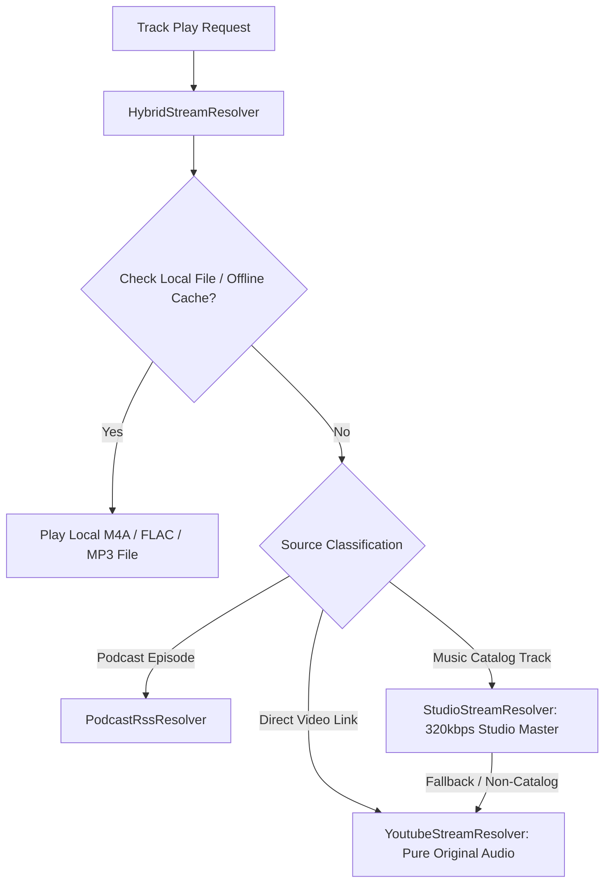

<div align="center">


# Softify

**An ad-free, paywall-free, high-fidelity mobile music streaming application for Android & iOS built with Flutter, Clean Architecture, and 320 kbps Studio Audio.**

[](https://flutter.dev)
[](https://dart.dev)
[](#-downloads--releases)
[](#-audio-engine--quality-settings)
[](#-architecture-highlights)
[](#-testing--quality-gates)
[](#-testing--quality-gates)
[](https://github.com/Sarthak-Cyb3r/softify/releases)
[](LICENSE)
[](CODE_OF_CONDUCT.md)

<br/><br/>

<a href="https://github.com/Sarthak-Cyb3r/softify/releases/download/v4.0.1/Softify-v4.0.1-Android.apk">
  
</a>
&nbsp;&nbsp;
<a href="https://github.com/Sarthak-Cyb3r/softify/releases/download/v4.0.1/Softify-Linux-x64.tar.gz">
  
</a>
&nbsp;&nbsp;
<a href="https://github.com/Sarthak-Cyb3r/softify/releases/latest">
  
</a>

</div>

---

> [!IMPORTANT]
> **This project is built for educational purposes and personal use. It is not affiliated with, endorsed by, or connected to Spotify, YouTube, or JioSaavn. No copyrighted content is hosted on this app.**

> [!NOTE]
> **Beta Status**: Softify is currently in **Beta**, and several features are pending. If bugs are found or you have suggestions, please contact the developer or submit an issue.

---

## 📖 Overview

**Softify** brings the premium music listening experience back to the listener. It delivers unrestricted, high-fidelity music streaming, instant search, synchronized lyrics, custom playlists, and offline downloads without subscriptions, audio or visual advertisements, or account paywalls.

Built from the ground up using **Flutter** and strict **Clean Architecture**, Softify operates entirely **client-side** with zero central backend infrastructure, zero API key requirements, and zero telemetry tracking.

---

## 📥 Downloads & Releases

Download pre-compiled binaries directly from [GitHub Releases](https://github.com/Sarthak-Cyb3r/softify/releases):

| Platform | Format | Compatibility | Size | Link |
| :--- | :--- | :--- | :--- | :--- |
| **Android (Android 8.0+)** | `.apk` | Universal APK (ARM64, ARMv7, x86_64) • Android 8.0+ | **~29.3 MB** | [`Softify-v4.0.1-Android.apk`](https://github.com/Sarthak-Cyb3r/softify/releases/latest) |
| **Linux (Desktop x64)** | `.tar.gz` | Standalone binary bundle (Ubuntu, Debian, Arch, Fedora) | **~15.1 MB** | [`Softify-Linux-x64.tar.gz`](https://github.com/Sarthak-Cyb3r/softify/releases/latest) |
| **Linux (CLI Installer)** | Script | Terminal installer with automated desktop integration | < 1 MB | [`install.sh`](https://raw.githubusercontent.com/Sarthak-Cyb3r/softify/main/install.sh) |
| **iOS (Sideload / AltStore)** | `.ipa` | iPhone & iPad • iOS 15.0+ | ~10.4 MB | [`Softify-iOS-Universal.ipa`](https://github.com/Sarthak-Cyb3r/softify/releases/latest) |

### 🐧 Linux Installation (Terminal-Based):
Softify provides a native, low-memory-conscious terminal installer with automatic package manager detection, desktop integration (`.desktop`, icons), and hardware-aware build throttling.

#### One-Line Installation:
```bash
curl -fsSL https://raw.githubusercontent.com/Sarthak-Cyb3r/softify/main/install.sh | bash
```

#### From Local Repository:
```bash
chmod +x install.sh
./install.sh
```

#### Installer Options:
- `./install.sh --build` : Build and install native Linux binary from local source code (auto-restricts to single-thread compilation on $\le 5$ GB RAM systems to prevent memory exhaustion).
- `./install.sh --system`: Install system-wide into `/usr/local/bin` (requires `sudo`).
- `./install.sh --uninstall`: Cleanly remove binary, desktop launcher, and application icons.
- `./install.sh --yes`: Unattended non-interactive install.

#### 🔄 Updating on Linux:
To update Softify on Linux to the latest version, simply run the one-line installer command (your playlists, downloaded tracks, and settings are preserved):
```bash
curl -fsSL https://raw.githubusercontent.com/Sarthak-Cyb3r/softify/main/install.sh | bash
```

To update or pin to a specific release tag (e.g. `v4.0.1`):
```bash
curl -fsSL https://raw.githubusercontent.com/Sarthak-Cyb3r/softify/main/install.sh | SOFTIFY_VERSION=v4.0.1 bash
```

If you installed from a local git repository:
```bash
git pull
./install.sh
```

#### ⌨️ Desktop Keyboard Shortcuts:
| Shortcut | Action |
| :--- | :--- |
| `Space` | Toggle Play / Pause |
| `Ctrl` + `→` | Skip to Next Track |
| `Ctrl` + `←` | Previous Track |
| `Ctrl` + `↑` / `Ctrl` + `↓` | Volume Up / Down (5% step) |
| `Ctrl` + `S` or `Ctrl` + `F` | Focus Search Screen |
| `Ctrl` + `H` | Navigate to Home Screen |
| `Ctrl` + `L` | Navigate to Library Screen |
| `Ctrl` + `,` | Open Settings Screen |

### 🤖 Android Installation:
1. Download **`Softify-v4.0.1-Android.apk`** (~29.3 MB) from [GitHub Releases](https://github.com/Sarthak-Cyb3r/softify/releases/latest).
2. Tap the `.apk` file in your browser downloads or file manager.
3. Grant **"Allow from this source"** in Android Settings if prompted, then tap **Install**.

### 🍎 iOS Installation & Sideloading Guide:
Because Softify is open-source and not distributed via the App Store, iOS users can install **`Softify-iOS-Universal.ipa`** using standard iOS sideloading tools:

#### Option 1: Sideloadly (Recommended for Windows & Mac)
1. Download and install [Sideloadly](https://sideloadly.io/) on your PC or Mac.
2. Connect your iPhone or iPad via USB cable (or enable Wi-Fi sync in iTunes/Finder).
3. Download **`Softify-iOS-Universal.ipa`** from [GitHub Releases](https://github.com/Sarthak-Cyb3r/softify/releases).
4. Drag and drop the `.ipa` into the Sideloadly window.
5. Enter your Apple ID and click **Start**.
6. Once installed, go to **Settings → General → VPN & Device Management** on your iPhone, select your Apple ID, and tap **Trust**.

#### Option 2: AltStore / SideStore (Wireless On-Device Refresh)
1. Install [AltStore](https://altstore.io/) or [SideStore](https://sidestore.io/) on your device.
2. Download **`Softify-iOS-Universal.ipa`** on your iPhone using Safari.
3. Open AltStore, tap the **My Apps** tab, tap the **`+`** icon in the top corner, and select the downloaded IPA.
4. AltStore will sign and install Softify, automatically refreshing its certificate over your local Wi-Fi network.

#### Option 3: TrollStore (iOS 14.0 – 17.0)
If your device is running a TrollStore-compatible iOS version:
1. Download **`Softify-iOS-Universal.ipa`** in Safari.
2. Tap the Share sheet → Select **Open in TrollStore**.
3. Softify will install instantly and **permanently** without 7-day certificate expiration or app limits.

> [!TIP]
> **First-Time iOS Launch**: If iOS displays *"Untrusted Developer"*, simply open **Settings → Privacy & Security → Developer Mode** (enable and reboot if on iOS 16+) and trust your profile in **Settings → General → VPN & Device Management**.

---

## ✨ Features & Highlights

### 1. 🧑‍🎤 Multi-Artist Navigation & Discography Chooser
- **Collaborative Artist Selector**: When a track features multiple collaborating artists (separated by `,`, `&`, `feat.`, `ft.`, `with`, `/`, `;`), clicking "View artist" or tapping the artist on the player opens a clean bottom sheet to choose which specific artist's discography and albums to explore.
- **Direct Fast Path**: Single-artist tracks navigate straight to the artist's full catalog, top tracks, and albums.
- **Deep-Dive Discography**: Dedicated discography explorer on Artist Detail screens organizing releases by Albums, Singles, and Compilations.
- **Smart Artist Radio**: Isolates primary artists from collaborative credit strings, generating coherent queues anchored by PPMI co-occurrence graphs.

### 2. 🎧 320kbps Studio Master Audio & Original Audio Engine
- **Pure 320kbps Studio Masters**: Direct decoding of uncompressed 320kbps AAC studio masters (`AudioQualityPreset.high`) with zero movie dialogue clips or multiplexing overhead.
- **Original Audio Stream Preservation**: Intelligent auto-dubbing filter detects and strips foreign-language translated audio tracks (`isAutoDubbed: true`), guaranteeing playback of the creator's authentic original audio.
- **Working Audio Quality Selector**: Instant switching between Low (96 kbps), Medium (160 kbps), and High (320 kbps Studio Master) with active resolver bitrate enforcement.
- **DJ Audio Crossfade & Loudness Normalization**: Smooth dual-engine volume interpolation between active and preloaded tracks (0s to 12s) and perceived loudness leveling (ReplayGain / EBU R128).
- **Audiophile Micro-Pill**: Live badge in MiniPlayer displaying active codec/bitrate (`320 KBPS`, `FLAC`, `AAC`) with a 1-tap modal inspecting buffer health and DAC pipelines.

### 3. 🎛️ 10-Band Hardware DSP Equalizer & Bass Boost
- **Native Hardware DSP**: Android AudioEffect integration and Linux PipeWire/PulseAudio sink filtering with zero latency.
- **Precision Frequency Control**: 10 parametric frequency bands (31Hz, 62Hz, 125Hz, 250Hz, 500Hz, 1kHz, 2kHz, 4kHz, 8kHz, 16kHz) with fine gain stepping (-12dB to +12dB).
- **Acoustic Presets**: Quick 1-tap presets: Bass Boost, Vocal Clarity, Electronic, Rock, Acoustic, and Flat.
- **Full-Width Desktop Console & Quick Launch**: Responsive layout with dedicated EQ tune button in Full-Screen Player and track options menu.

### 4. 🎤 Synced Karaoke Lyrics & On-Device Romanization
- **Kinetic Vocal Tracking**: Synchronized LRC lyrics with kinetic line highlighting, optical depth blur, and smooth auto-scrolling.
- **On-Device ScriptRomanizer**: Zero-network, deterministic transliterator converting Devanagari (Hindi, Marathi, Nepali, Sanskrit) and Gurmukhi (Punjabi) into Latin phonetics in real-time.
- **Instant [ROM] / [ORIG] Toggle**: Seamless one-tap switch in lyrics header for sing-along without external API latency.
- **Interactive Font Sizing & Quote Cards**: Dynamic typography scaling (Compact 17px, Normal 21px, Large 26px) and long-press quote card sharing.
- **Composite Fallback Cascade**: High-coverage fallback across LRCLIB, JioSaavn, and NetEase lyrics databases.

### 5. 🔍 Instant Search & Spotify Metadata Catalog
- **Sub-100ms Debounced Search**: Multi-source instant search with typo-tolerant fuzzy matching and autocomplete.
- **Functional Filter Tabs**: Fast instant tab filtering between **All**, **Songs**, and **Artists**.
- **Spotify Primary Metadata Engine**: Rich metadata extraction directly from Spotify catalog for albums, artists, tracks, and discographies.
- **Smart Catalog Deduplication**: Collapses duplicate remix and compilation clones into original studio recordings; strips noisy intro dialogues.
- **Language-Aware Mood Explorer**: Instant browsing across moods and genres personalized to the user's native listening languages.

### 6. 🏠 Home & Dynamic Taste Discovery
- **Streamlined Bento Grid**: Compacted Liked Songs and Downloads row pulling "Made For You" and "Recently Played" shelves to the top.
- **Contextual Greetings**: Dynamic time-of-day greetings tailored for both desktop and mobile viewports.
- **Taste-Based Shelves**: Auto-generated recommendations (Based on your recent listening, Heavy Rotation, Forgotten Favorites).
- **Verified Regional Top Charts**: Direct access to Hindi Superhits Top 50, Punjabi Top 50, International Top 50, and Trending Today.

### 7. 📁 Local Device Music & Offline File Player
- **Zero-Network File Player**: Scans device storage for `.mp3`, `.m4a`, `.flac`, `.wav`, `.ogg`, and `.aac` audio files.
- **Smart Noise Exclusion**: Filters out UI clicks, short audio beeps (<300KB), app assets, `.nomedia` folders, and build artifacts.
- **Offline Library Doctor**: 1-tap verification scans filesystem, cleans orphaned cache files, and re-syncs physical file sizes.
- **1-Tap Folder Opener**: Direct button in Downloads tab and Settings to open saved tracks natively via system file managers.

### 8. 📊 Softify Wrapped & On-Device Insights
- **Interactive Analytics Dashboard**: Listening archetypes, total streaming hours, top songs, and top artists.
- **Multi-Period Filters & 24h Rhythm**: Filter insights across All Time, Past 30 Days, and Past 7 Days with 24-column hourly activity charts.
- **Shareable AMOLED Poster Card**: 1-click clipboard summary export and social sharing cards.

### 9. ⏱️ Precision Sleep Timer & Keyless Tools
- **Precision Sleep Timer**: Quick presets (5m, 10m, 15m, 30m, 45m, 1h), custom duration, or "End of this song" running safely under locked screens.
- **Keyless Playlist Importer**: Import public playlists via URL/ID without account credentials or API keys.
- **Encrypted Local Backup**: 1-click export and restore of playlists, liked tracks, history, and settings via `.softify` archives.

### 10. 📱 Ecosystem & OS Integrations
- **Material You Android Widgets**: 4×1 compact pill and 4×2 expansive card home-screen widgets with dynamic system color accents.
- **Desktop Discord Rich Presence**: Live "Listening to..." presence with track title, artist, and timestamps via local Unix IPC socket.
- **Landscape Car Mode & Linux Mobile Viewport**: High-contrast large-target driving mode and native `--mobile` CLI testing flag.
- **iOS Media Session**: Dynamic Island (`MPRemoteCommandCenter`), lock screen controls, and AirPods stem gesture support.

---

## 🏛️ Architecture Highlights

Softify is built upon strict **Clean Architecture** principles, maintaining absolute decoupling between business logic, external infrastructure, and UI presentation:

```
lib/
├── domain/                    # Pure Dart business rules (Zero Flutter/Drift dependencies)
│   ├── entities/              # Track, SearchCandidate, SearchIntent, AudioQualityPreset, Playlist
│   └── ports/                 # Inverted interfaces (IStreamResolver, IVectorSearchEngine, etc.)
├── data/                      # Concrete data providers & on-device machine learning
│   ├── catalog/               # KeylessYouTubeCatalog (Deduplication + Autocomplete)
│   ├── database/              # Drift SQLite relational ORM (AppDatabase with 20 tables + FTS5)
│   ├── evaluation/            # TeamDraftInterleaver, GuardrailRunner (Latency & Golden Benchmarks)
│   ├── lyrics/                # LRCLIB, JioSaavn, NetEase, ScriptRomanizer (Devanagari & Gurmukhi)
│   ├── player/                # SoftifyAudioHandler (Dual-engine pre-buffering pipeline)
│   ├── recommendations/       # Taste profiles, PPMI graph, LogisticRanker, ShelfEngine, MMR, Bandit
│   ├── repositories/          # DriftLibraryRepository, DriftEventLogger, DriftFtsRepository
│   ├── resolvers/             # SaavnStreamResolver (320kbps), YoutubeStreamResolver, HybridStreamResolver
│   ├── search/                # VectorSearchEngine, LinearSearchReranker, RuleIntentRouter
│   ├── services/              # SpotifyApiService, MusicLanguageService, LocalAudioScanner, DiscordRpcService
│   └── tagging/               # M4aAtomTagger (iTunes MP4 atom tagging)
└── presentation/              # Reactive UI layer (Flutter + Riverpod)
    ├── providers/             # Cached Riverpod audio, queue, search, and settings providers
    ├── screens/               # HomeScreen, SearchScreen, LibraryScreen, FullScreenPlayerScreen, WrappedScreen
    └── widgets/               # MiniPlayer, LyricsView, QueueBottomSheet, EqualizerSheet, ArtistChooserBottomSheet
```

### Hybrid Resolution Chain


---

## 🛠️ Building from Source

### Prerequisites
- [Flutter SDK](https://flutter.dev/docs/get-started/install) (`>= 3.19.0`, recommended `3.47.6` or latest stable)
- [Dart SDK](https://dart.dev) (`>= 3.3.0`)
- [Android SDK](https://developer.android.com/studio) (API 34+ recommended, minimum API 26)
- Java Development Kit (JDK 17+)

### Step-by-Step Build Instructions

1. **Clone the repository**:
   ```bash
   git clone https://github.com/Sarthak-Cyb3r/softify.git
   cd softify
   ```

2. **Install Flutter dependencies**:
   ```bash
   flutter pub get
   ```

3. **Generate Drift SQLite code**:
   ```bash
   dart run build_runner build --delete-conflicting-outputs
   ```

4. **Run static analysis and tests**:
   ```bash
   flutter analyze
   flutter test
   ```

5. **Build Android Release (Universal APK)**:
   ```bash
   flutter build apk --release
   ```
   The compiled APK will be at `build/app/outputs/flutter-apk/app-release.apk`.

6. **Build iOS Release (macOS with Xcode 15+)**:
   ```bash
   # Compile iOS Release Archive (Swift Package Manager, no CocoaPods step)
   flutter build ipa --no-codesign --release

   # Package into Sideloadable IPA
   cd build/ios/archive/Runner.xcarchive/Products/Applications
   mkdir -p Payload && cp -r Runner.app Payload/
   zip -r ../../../../../Softify-iOS-Universal.ipa Payload && cd ../../../../..
   ```

---

## 🧪 Testing & Quality Gates

Softify maintains strict quality engineering standards with 100% test coverage for critical domain rules and resolvers:

```bash
# Run the complete automated test suite
flutter test

# Run static analysis
flutter analyze
```

- **Analysis Status**: `0 issues found` (clean lint profile).
- **Unit & Integration Tests**: `All tests passing (100%) across 64 test suites`.
- **Test Corpus**: Validates core engine, AI recommendation pipelines, and UI integrity:
  - Multi-Artist Parsing & Selection Engine (`parseArtistNames`, delimiter splitting, `ArtistChooserBottomSheet`)
  - Stream Resolution & Auto-Dubbing Filtering (`YoutubeInnertubeService`, original creator audio priority, auto-dubbed stream exclusion)
  - Telemetry & Event Logging (`DriftEventLogger`, 30s stream rule, fire-and-forget execution)
  - FTS5 Full-Text Retrieval & Fuzzy Aliases (`DriftFtsRepository`, `TextNormalizer`, `LinearSearchReranker`)
  - Taste Decay & PPMI Co-occurrence Graph (`DriftTasteProfileRepository`, `DriftCooccurrenceRepository`)
  - Pointwise Logistic Regression Ranker & Algotorial Shelves (`LogisticRegressionRanker`, `ShelfEngine` 10% anchor rule)
  - Autocomplete & Intent Routing (`MultiSourceAutocomplete`, `RuleIntentRouter`)
  - Automix Tail Reordering & Untouchable $N+1$ Pre-buffer Invariant (`AutomixTailReorderer`, `EpsilonGreedyBandit`, `KlDivergenceCalibrator`)
  - MMR Diversity & Discovery Agency (`MmrDiversityRanker`, 30-day artist snooze, Spotify cold-start seeder)
  - Team-Draft Interleaving & Latency Guardrails (`TeamDraftInterleaver`, `GuardrailRunner`, 54 golden query benchmarks)
  - Semantic Vector Search (`VectorSearchEngine`, cosine similarity, 128-dim subword trigram vector hashing)
  - Core Audio & Stream Engines (`SaavnStreamResolver` 320kbps verification, `HybridStreamResolver`, `YoutubeStreamResolver`, `M4aAtomTagger`, `SoftifyAudioHandler`)

---

## 📜 Release Notes & Changelog

All release notes, historical changelogs, and upgrade highlights are preserved in [CHANGELOG.md](CHANGELOG.md) and on [GitHub Releases](https://github.com/Sarthak-Cyb3r/softify/releases).

---

## 🤝 Credits & Acknowledgements

- **Metrolist Project**: Architectural patterns, design aesthetics, and the original Listen Together protocol specification (`MetrolistGroup/metroproto`, `MetrolistGroup/metroserver`), licensed under GPL-3.0.
- **SimpMusic**: Kotlin Multiplatform audio reference and Listen Together protocol client implementation (`org.simpmusic.listentogether`), licensed under GPL-3.0.
- **Flutter & Community**: The open-source Flutter ecosystem, Riverpod, Drift, and just_audio / media_kit contributors.

---

## ⚖️ Legal & Disclaimer

> [!IMPORTANT]
> **This project is built for educational purposes and personal use. It is not affiliated with, endorsed by, or connected to Spotify, YouTube, or JioSaavn. No copyrighted content is hosted on this app.**

- Softify does not bypass or circumvent any digital rights management (DRM) or proprietary encryption mechanisms.
- All metadata and audio streams are retrieved client-side from publicly available endpoints.
- Users are solely responsible for ensuring their personal use complies with local laws and terms of service.

---

## 📄 License & Code of Conduct

- Softify is distributed under the [GNU General Public License v3.0 (GPL-3.0)](LICENSE).
- All community interactions, issues, and contributions are governed by the [Contributor Covenant Code of Conduct](CODE_OF_CONDUCT.md).
