<div align="center">


# Softify

**An ad-free, paywall-free, high-fidelity mobile music streaming application for Android & iOS built with Flutter, Clean Architecture, and 320 kbps Studio Audio.**

[](https://flutter.dev)
[](https://dart.dev)
[](#-downloads--releases)
[](#-audio-engine--quality-settings)
[](#-architecture-highlights)
[](#-testing--quality-gates)
[](#-testing--quality-gates)
[](https://github.com/Sarthak-Cyb3r/softify/releases)
[](LICENSE)
[](CODE_OF_CONDUCT.md)

</div>

---

> [!IMPORTANT]
> **This project is built for educational purposes and personal use. It is not affiliated with, endorsed by, or connected to Spotify, YouTube, or JioSaavn. No copyrighted content is hosted on this app.**

> [!NOTE]
> **Beta Status**: Softify is currently in **Beta**, and several features are pending. If bugs are found or you have suggestions, please contact the developer or submit an issue.

---

## 📖 Overview

**Softify** brings the premium music listening experience back to the listener. It delivers unrestricted, high-fidelity music streaming, instant search, synchronized lyrics, custom playlists, and offline downloads without subscriptions, audio or visual advertisements, or account paywalls.

Built from the ground up using **Flutter** and strict **Clean Architecture**, Softify operates entirely **client-side** with zero central backend infrastructure, zero API key requirements, and zero telemetry tracking.

---

## 📱 Screenshots

<div align="center">

| Home & Dynamic Shelves | Instant Search & Deduplication | Full-Screen Studio Player | Synced Karaoke Lyrics |
|:---:|:---:|:---:|:---:|
| 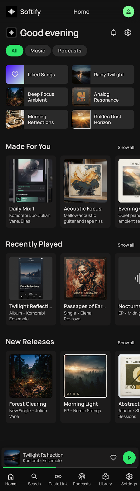 | 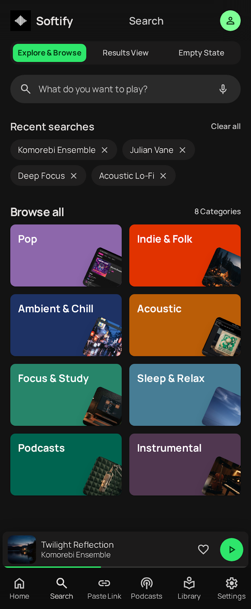 | 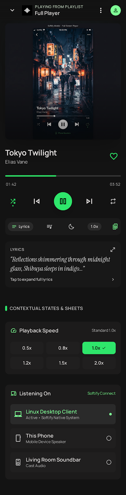 | 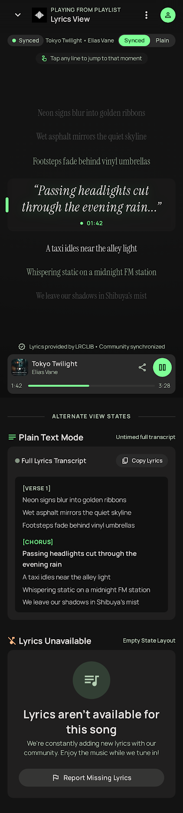 |

<br/>

| Your Library & Local Music | Artist Discography | 10-Band Hardware DSP EQ | On-Device Wrapped Insights |
|:---:|:---:|:---:|:---:|
| 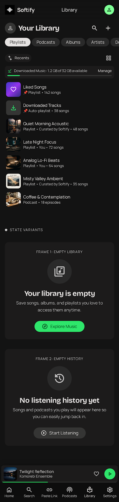 | 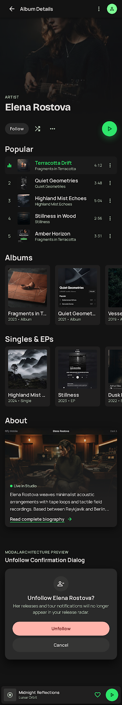 | 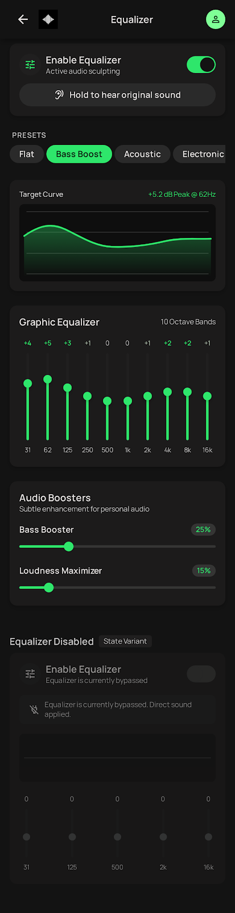 | 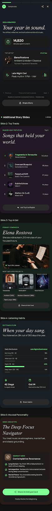 |

<br/>

| Album Deep-Dive | Landscape Car Mode | Direct Video Link Player | Audiophile Cache & Settings |
|:---:|:---:|:---:|:---:|
| 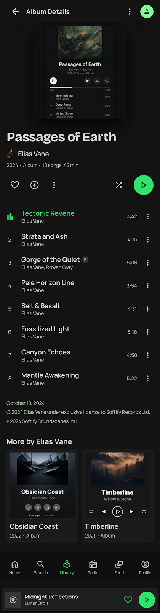 | 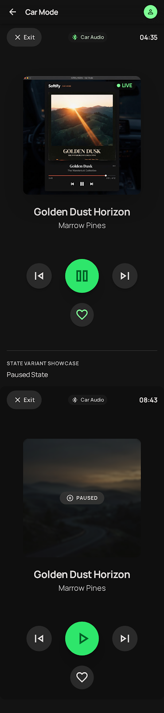 | 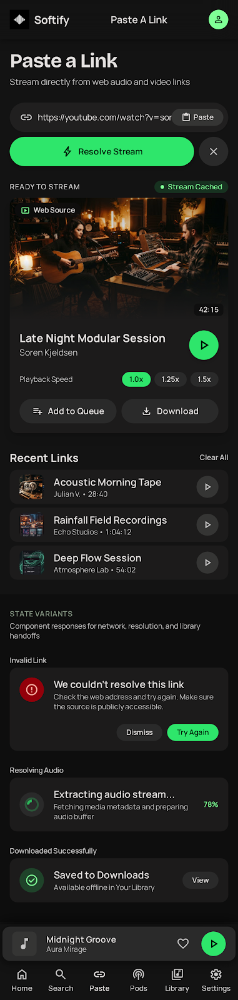 | 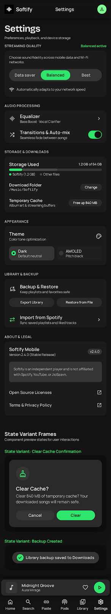 |

</div>

---

## 📥 Downloads & Releases

Download pre-compiled binaries directly from [GitHub Releases](https://github.com/Sarthak-Cyb3r/softify/releases):

| Platform | Format | Compatibility | Size | Link |
| :--- | :--- | :--- | :--- | :--- |
| **Android (Android 8.0+)** | `.apk` | 64-bit Android devices • Android 8.0+ | **~19 MB** | [`Softify-v3.0.8-Android.apk`](https://github.com/Sarthak-Cyb3r/softify/releases/latest) |
| **iOS (Sideload / AltStore)** | `.ipa` | iPhone & iPad • iOS 15.0+ | ~10.4 MB | [`Softify-iOS-Universal.ipa`](https://github.com/Sarthak-Cyb3r/softify/releases/latest) |
| **Linux (Desktop / CLI Installer)** | Script / Binary | Ubuntu, Debian, Arch, Fedora, openSUSE (x86_64, ARM64) | ~45 MB | [`install.sh`](https://raw.githubusercontent.com/Sarthak-Cyb3r/softify/main/install.sh) |

### 🐧 Linux Installation (Terminal-Based):
Softify provides a native, low-memory-conscious terminal installer with automatic package manager detection, desktop integration (`.desktop`, icons), and hardware-aware build throttling.

#### One-Line Installation:
```bash
curl -fsSL https://raw.githubusercontent.com/Sarthak-Cyb3r/softify/main/install.sh | bash
```

#### From Local Repository:
```bash
chmod +x install.sh
./install.sh
```

#### Installer Options:
- `./install.sh --build` : Build and install native Linux binary from local source code (auto-restricts to single-thread compilation on $\le 5$ GB RAM systems to prevent memory exhaustion).
- `./install.sh --system`: Install system-wide into `/usr/local/bin` (requires `sudo`).
- `./install.sh --uninstall`: Cleanly remove binary, desktop launcher, and application icons.
- `./install.sh --yes`: Unattended non-interactive install.

#### 🔄 Updating on Linux:
To update Softify on Linux to the latest version, simply run the one-line installer command (your playlists, downloaded tracks, and settings are preserved):
```bash
curl -fsSL https://raw.githubusercontent.com/Sarthak-Cyb3r/softify/main/install.sh | bash
```

To update or pin to a specific release tag (e.g. `v2.9.1`):
```bash
curl -fsSL https://raw.githubusercontent.com/Sarthak-Cyb3r/softify/main/install.sh | SOFTIFY_VERSION=v2.9.1 bash
```

If you installed from a local git repository:
```bash
git pull
./install.sh
```

#### ⌨️ Desktop Keyboard Shortcuts:
| Shortcut | Action |
| :--- | :--- |
| `Space` | Toggle Play / Pause |
| `Ctrl` + `→` | Skip to Next Track |
| `Ctrl` + `←` | Previous Track |
| `Ctrl` + `↑` / `Ctrl` + `↓` | Volume Up / Down (5% step) |
| `Ctrl` + `S` or `Ctrl` + `F` | Focus Search Screen |
| `Ctrl` + `H` | Navigate to Home Screen |
| `Ctrl` + `L` | Navigate to Library Screen |
| `Ctrl` + `,` | Open Settings Screen |

### 🤖 Android Installation:
1. Download **`Softify-v2.9.1-Android.apk`** (~19 MB) from [GitHub Releases](https://github.com/Sarthak-Cyb3r/softify/releases/latest).
2. Tap the `.apk` file in your browser downloads or file manager.
3. Grant **"Allow from this source"** in Android Settings if prompted, then tap **Install**.

### 🍎 iOS Installation & Sideloading Guide:
Because Softify is open-source and not distributed via the App Store, iOS users can install **`Softify-iOS-Universal.ipa`** using standard iOS sideloading tools:

#### Option 1: Sideloadly (Recommended for Windows & Mac)
1. Download and install [Sideloadly](https://sideloadly.io/) on your PC or Mac.
2. Connect your iPhone or iPad via USB cable (or enable Wi-Fi sync in iTunes/Finder).
3. Download **`Softify-iOS-Universal.ipa`** from [GitHub Releases](https://github.com/Sarthak-Cyb3r/softify/releases).
4. Drag and drop the `.ipa` into the Sideloadly window.
5. Enter your Apple ID and click **Start**.
6. Once installed, go to **Settings → General → VPN & Device Management** on your iPhone, select your Apple ID, and tap **Trust**.

#### Option 2: AltStore / SideStore (Wireless On-Device Refresh)
1. Install [AltStore](https://altstore.io/) or [SideStore](https://sidestore.io/) on your device.
2. Download **`Softify-iOS-Universal.ipa`** on your iPhone using Safari.
3. Open AltStore, tap the **My Apps** tab, tap the **`+`** icon in the top corner, and select the downloaded IPA.
4. AltStore will sign and install Softify, automatically refreshing its certificate over your local Wi-Fi network.

#### Option 3: TrollStore (iOS 14.0 – 17.0)
If your device is running a TrollStore-compatible iOS version:
1. Download **`Softify-iOS-Universal.ipa`** in Safari.
2. Tap the Share sheet → Select **Open in TrollStore**.
3. Softify will install instantly and **permanently** without 7-day certificate expiration or app limits.

> [!TIP]
> **First-Time iOS Launch**: If iOS displays *"Untrusted Developer"*, simply open **Settings → Privacy & Security → Developer Mode** (enable and reboot if on iOS 16+) and trust your profile in **Settings → General → VPN & Device Management**.

---

## 🚀 Features & Capabilities

### 1. 🧑‍🎤 Multi-Artist Navigation & Discography Chooser
- **Collaborative Artist Selector**: When a track features multiple collaborating artists (e.g. separated by `,`, `&`, `feat.`, `ft.`, `with`, `/`, `;`), clicking *"View artist"* or tapping the artist on the player opens a clean dark bottom sheet allowing you to choose which specific artist's discography and albums to explore.
- **Direct 1-Artist Fast Path**: Tracks with a single artist bypass the dialog and navigate straight to the artist's full catalog and top tracks.
- **Deep-Dive Discography**: Dedicated *"Discography"* button on Artist Detail screens organizing all releases by Albums, Singles, and Compilations.
- **Smart Artist Radio**: Isolates primary artists from collaborative credit strings, generating musically coherent 25-song queues anchored by PPMI co-occurrence graphs.

### 2. 🎧 320kbps Studio Master Audio & Original Audio Engine
- **Pure 320kbps Studio Masters**: Direct decoding of uncompressed 320kbps AAC studio masters (`AudioQualityPreset.high`) with zero movie dialogue clips, sponsor voiceovers, or multiplexing overhead.
- **Original Audio Stream Preservation**: Intelligent auto-dubbing filter detects and strips foreign language translated audio tracks (`isAutoDubbed: true`, `acont=dubbed-auto`), guaranteeing playback of the creator's authentic original audio (`acont=original:lang=en-US`).
- **DJ Audio Crossfade Engine**: Smooth dual-engine volume interpolation between active and preloaded tracks with 0s to 12s configurable slider in Settings.
- **Loudness Normalization (ReplayGain / EBU R128)**: Perceived loudness leveling across diverse studio sources, eliminating volume jumps between quiet acoustic and loud modern recordings.
- **Audiophile Micro-Pill & Telemetry Inspector**: Live badge in MiniPlayer displaying active codec/bitrate (320 KBPS, FLAC, AAC) with a 1-tap modal inspecting buffer health and DAC pipelines.

### 3. 🎛️ 10-Band Hardware DSP Equalizer & Bass Boost
- **Native Hardware DSP**: Android `AudioEffect` integration and Linux PipeWire/PulseAudio sink filtering with zero latency.
- **Precision Frequency Control**: 10 parametric frequency bands (`31Hz`, `62Hz`, `125Hz`, `250Hz`, `500Hz`, `1kHz`, `2kHz`, `4kHz`, `8kHz`, `16kHz`) with fine gain stepping (-12dB to +12dB).
- **Acoustic Presets**: Quick 1-tap presets: Bass Boost, Vocal Clarity, Electronic, Rock, Acoustic, and Flat.
- **Full-Width Desktop Console**: Responsive layout ensuring all 10 bands are visible side-by-side with zero horizontal clipping.
- **Direct Player Quick Launch**: Dedicated `[EQ]` tune button in Full-Screen Player and track options menu for real-time auditioning.

### 4. 🎤 Synced Karaoke Lyrics & On-Device Romanization
- **Real-Time Vocal Tracking**: Synchronized LRC lyrics with kinetic line highlighting and smooth auto-scrolling.
- **On-Device ScriptRomanizer**: Zero-network, deterministic transliterator converting Devanagari (Hindi, Marathi, Nepali, Sanskrit) and Gurmukhi (Punjabi) into Latin phonetics in real-time.
- **Instant `[ROM]` / `[ORIG]` Toggle**: One-tap switch in lyrics header allowing seamless sing-along without external API latency.
- **Interactive Font Sizing**: Dynamic typography scaling (Compact 17px, Normal 21px, Large 26px) with preference persisted in local Drift SQLite.
- **Shareable Lyric Quote Cards**: Long-press any lyric line to generate and copy a styled quote snippet with track and artist attribution.
- **Composite Lyrics Fallback Cascade**: High-coverage fallback querying verified and community lyrics databases (including LRCLIB).

### 5. 🔍 Instant Search & Catalog Deduplication
- **Sub-100ms Debounced Search**: Multi-source instant search with typo-tolerant fuzzy matching and autocomplete.
- **Quality & Offline Filter Chips**: 1-tap filtering above search results to isolate `All`, `Studio (320k)` master recordings, or `Downloaded` offline tracks.
- **Smart Catalog Deduplication**: Collapses duplicate remix and compilation clones into original studio recordings; strips noisy intro dialogues.
- **Genre & Mood Explorer**: Instant browsing across Bollywood, Pop, Hip-Hop, Punjabi, Rock, Indie, Lo-Fi, and more.

### 6. 🏠 Home & Dynamic Taste Discovery
- **Streamlined Bento Grid**: Compacted "Liked Songs" and "Downloads" into a clean 52px-height row with 8px rounded corners on `#282828` background, pulling "Made For You" and "Recently Played" shelves to the top.
- **Personalized Contextual Greetings**: Dynamic time-of-day greetings tailored for both desktop and mobile layouts.
- **Taste-Based Shelves**: Auto-generated recommendations (*"Based on your recent listening"*, *Heavy Rotation*, *Forgotten Favorites*).
- **Verified Regional Top Charts**: Direct 1-hop access to Hindi Superhits Top 50, Punjabi Top 50, International Top 50, and Trending Today.

### 7. 📁 Local Device Music & Offline File Player
- **Zero-Network File Player**: Scans device storage for `.mp3`, `.m4a`, `.flac`, `.wav`, `.ogg`, and `.aac` audio.
- **Smart Noise Exclusion**: Filters out UI clicks, short beeps (<300KB), app assets, `.nomedia` folders, and development directories (`node_modules`, `build`, etc.).
- **Automatic Pruning**: Deleted or moved files are automatically purged from the library on rescan.
- **Multi-Sort Library Header**: Sort Liked Songs, Downloads, and Local Music by `Recent`, `Title A-Z`, or `Artist A-Z` with instant batch "Play All" and "Shuffle".
- **Offline Library Doctor**: 1-tap "Verify & Repair Offline Library" scans filesystem, cleans orphaned cache files, and re-syncs physical file sizes.
- **1-Tap Folder Opener**: Direct button in Downloads tab and Settings to open the saved tracks folder natively via `xdg-open` (Linux), `open` (macOS), `explorer.exe` (Windows), or Android Files.

### 8. 📊 Softify Wrapped & On-Device Listening Insights
- **Interactive Analytics Dashboard**: Listening archetypes (*Night Explorer*, *Sonic Voyager*, *Deep Diver*, *Morning Energizer*, etc.), total streaming hours, top songs, and top artists.
- **Multi-Period Filters**: Filter insights across *All Time*, *Past 30 Days*, and *Past 7 Days*.
- **24-Hour Rhythm & Clock**: 24-column hourly activity bar chart and day-quadrant breakdown.
- **Shareable Card**: AMOLED poster-style Wrapped card with 1-click clipboard summary export.
- **Dynamic Smart Playlists**: Self-updating playlists (*On Repeat*, *Most Played This Month*, *Forgotten Favorites*).

### 9. ⏱️ Precision Sleep Timer Engine
- **Quick Presets & End-of-Song**: 5m, 10m, 15m, 30m, 45m, 1h, custom duration (1–1440m), or "End of this song".
- **Background-Safe Precision**: Governed by foreground audio handler to reliably halt audio when the screen is locked.
- **Queue Protection**: Prevents automatic next-track queue advancement once the timer expires.

### 10. 🔄 1-Click Playlist Importer & Encrypted Backup
- **Keyless Playlist Importer**: Import public playlists via URL/ID without account credentials or developer keys.
- **Portable Encrypted Backup**: 1-click export and restore of playlists, liked songs, history, and settings into a standalone `.softify` archive.

### 11. 📱 Ecosystem & OS Integrations
- **Material You Android Widgets**: 4×1 compact pill and 4×2 expansive card home-screen widgets with dynamic system colors.
- **Desktop Discord Rich Presence**: Live "Listening to..." presence with track title, artist, and timestamps via local Unix IPC socket.
- **Landscape Car Mode**: Large-target, high-contrast driving mode for automotive head units and mounts.
- **Linux Mobile Viewport Mode**: Native `--mobile` command-line switch and `SOFTIFY_MOBILE=1` environment flag for testing phone viewports on desktop Linux.
- **iOS Media Session**: Lock screen controls, Dynamic Island (`MPRemoteCommandCenter`), and AirPods stem gesture support.

---

## 🧠 Softify v2.0 On-Device Intelligence & Recommendation Engine

Softify v2.0 introduces a state-of-the-art, **100% client-side, zero-telemetry** recommendation and search intelligence engine running entirely on local SQLite/Drift tables without any remote machine learning servers:

### 1. ⚡ Local-First Instant Search & FTS5 Retrieval (S1, S2, S3)
- **Sub-100ms Latency Budget**: Instant debounced search (120ms debounce) that prioritizes local results before blending remote catalog hits.
- **SQLite FTS5 Virtual Table**: Full-text prefix indexing across tracks, artists, and playlists with diacritic normalization and punctuation stripping.
- **Fuzzy Damerau-Levenshtein Matching & Aliases**: Seamless handling of typos, spelling variants, and curated music aliases.
- **Linear Re-Ranker with Exact-Match Invariant**: Blends BM25 lexical signals, recency, and stream history with a hard `+10.0` score boost ensuring exact search matches always rank #1.

### 2. 📈 Dual-Band Taste Decay & Co-occurrence Sentence Graph (R1, R2)
- **Dual-Band Half-Life Decay**: Models user affinity with two concurrent exponential decay bands:
  - Fast-decay band ($W_{\text{fast}}$: 4-hour half-life) capturing immediate listening moods and session trends.
  - Slow-decay band ($W_{\text{slow}}$: 14-day half-life) capturing enduring genre and artist taste.
- **Session Sentence Graph & PPMI**: Treats listening sessions (interrupted by $\le 60\text{s}$ gaps) as natural language "sentences" to compute Positive Pointwise Mutual Information (PPMI) between co-occurring tracks off the main thread.

### 3. 🎯 Pointwise Logistic Regression & Algotorial Shelves (R3, R4)
- **On-Device SGD Model**: Computes stream probabilities $\sigma(z) = 1/(1+e^{-z})$ directly on device from features including taste affinity, recency, skip penalties, and source weights.
- **Skip Sensitivity Rule**: Dynamically applies a $>50\%$ penalty when an artist or track suffers $\ge 3$ consecutive skips.
- **Dynamic Algotorial Shelves**:
  - *Heavy Rotation*: High-affinity tracks weighted by both slow and fast taste bands.
  - *Forgotten Favorites*: Deep catalog gems not listened to in $>30$ days.
  - *Discover Weekly*: Curated discovery with a strict **~10% familiar anchor ratio** (1 anchor track per 10 recommendations) to ground exploration in familiar favorites.

### 4. 🧭 Multi-Source Autocomplete & Offline Intent Routing (S4, S5)
- **Multi-Source Sealed Intent Autocomplete**: Merges candidate suggestions from 5 distinct sources (recent queries, library matches, cached history, popular artists, and fuzzy matches).
- **Rule-Based Intent Router**: Instantly classifies user queries into structured intents (`TrackIntent`, `ArtistIntent`, `MoodOrGenreIntent`, `DiscoverIntent`, or `NavigationalIntent`) without remote LLM latency.

### 5. 🔀 Dynamic Queue Reordering & Pre-Buffer Invariant (R5, R6)
- **Player Pre-Buffer Invariant**: The secondary player engine pre-buffers track $N+1$ approximately 15 seconds before track $N$ completes. Softify strictly guarantees that **Track $N$ and Track $N+1$ are never mutated, re-ordered, or canceled**. Re-ranking occurs exclusively on the unbuffered tail ($\ge N+2$).
- **Contextual Epsilon-Greedy Bandit**: Balances exploitation with exploration across novelty arms (`0.0, 0.1, 0.2, 0.3, 0.5`) to prevent recommendation echo-chambers.
- **Kullback-Leibler (KL) Divergence Calibration**: Calibrates recommended genre distributions against historical listening profiles, minimizing $D_{\text{KL}}(P \parallel Q)$.

### 6. 🛡️ Discovery Agency, MMR Diversity & Privacy Controls (R7, R8)
- **Maximal Marginal Relevance (MMR)**: Penalizes redundant artists with a hard `maxPerArtist = 2` cap per recommendation shelf.
- **30-Day Artist Snoozing**: 1-tap option to temporarily exclude any artist from recommendations and autocomplete for 30 days.
- **Incognito Taste Mode**: Pause all profile learning during shared or party sessions.
- **1-Line Transparent Explanations**: Every recommendation surfaces a clear rationale (*"Because you listened to The Weeknd"*, *"From your Heavy Rotation"*).
- **Cold-Start Seeding**: Seamless onboarding genre selection and instant taste profile seeding from imported Spotify playlists.

### 7. ⚖️ Radlinski Team-Draft Interleaving & Latency Guardrails (E1, E2)
- **On-Device Team-Draft Interleaving**: Fairly evaluates candidate ranking models in vivo with a 10% baseline holdback slot to measure true user preference without telemetry.
- **Automated Latency Guardrails**: Continuous verification requiring search responses to pass $p75 < 100\text{ ms}$ over 50 consecutive queries.
- **Golden Query Suite**: 54 diverse benchmark queries spanning popular artists, exact titles, typos, and multi-lingual transliterations.

### 8. 🧬 On-Device Semantic Vector Search (E3)
- **128-Dimensional Float32 Embeddings**: Compact local vector representations computed via subword character trigram and word hash projections.
- **Zero-Network Vector Retrieval**: L2-normalized cosine similarity computed directly against SQLite `track_embeddings` table. Adds $<1\text{ MB}$ to binary size with zero 100MB+ TensorFlow Lite dependencies.

---

## 🏛️ Architecture Highlights

Softify is built upon strict **Clean Architecture** principles, maintaining absolute decoupling between business logic, external infrastructure, and UI presentation:

```
lib/
├── domain/                    # Pure Dart business rules (Zero Flutter/Drift dependencies)
│   ├── entities/              # Track, SearchCandidate, SearchIntent, AudioQualityPreset, Playlist
│   └── ports/                 # Inverted interfaces (IStreamResolver, IVectorSearchEngine, etc.)
├── data/                      # Concrete data providers & on-device machine learning
│   ├── catalog/               # KeylessYouTubeCatalog (Deduplication + Autocomplete)
│   ├── database/              # Drift SQLite relational ORM (AppDatabase with 20 tables + FTS5)
│   ├── evaluation/            # TeamDraftInterleaver, GuardrailRunner (Latency & Golden Benchmarks)
│   ├── player/                # SoftifyAudioHandler (Dual-engine pre-buffering pipeline)
│   ├── recommendations/       # Taste profiles, PPMI graph, LogisticRanker, ShelfEngine, MMR, Bandit
│   ├── repositories/          # DriftLibraryRepository, DriftEventLogger, DriftFtsRepository
│   ├── resolvers/             # SaavnStreamResolver (320kbps), YoutubeStreamResolver, HybridStreamResolver
│   ├── search/                # VectorSearchEngine, LinearSearchReranker, RuleIntentRouter
│   └── tagging/               # M4aAtomTagger (iTunes MP4 atom tagging)
└── presentation/              # Reactive UI layer (Flutter + Riverpod)
    ├── providers/             # Cached Riverpod audio, queue, search, and settings providers
    ├── screens/               # HomeScreen, SearchScreen, LibraryScreen, FullScreenPlayerScreen, DebugMetricsScreen
    └── widgets/               # MiniPlayer, LyricsView, QueueBottomSheet, IntentSuggestionChips
```

### Hybrid Resolution Chain
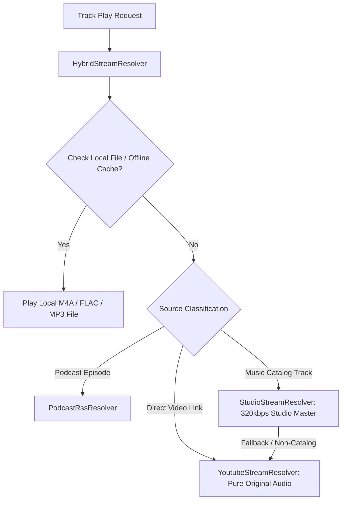

---

## 🛠️ Building from Source

### Prerequisites
- [Flutter SDK](https://flutter.dev/docs/get-started/install) (`>= 3.19.0`, recommended `3.47.6` or latest stable)
- [Dart SDK](https://dart.dev) (`>= 3.3.0`)
- [Android SDK](https://developer.android.com/studio) (API 34+ recommended, minimum API 26)
- Java Development Kit (JDK 17+)

### Step-by-Step Build Instructions

1. **Clone the repository**:
   ```bash
   git clone https://github.com/Sarthak-Cyb3r/softify.git
   cd softify
   ```

2. **Install Flutter dependencies**:
   ```bash
   flutter pub get
   ```

3. **Generate Drift SQLite code**:
   ```bash
   dart run build_runner build --delete-conflicting-outputs
   ```

4. **Run static analysis and tests**:
   ```bash
   flutter analyze
   flutter test
   ```

5. **Build Android Release (Universal APK)**:
   ```bash
   flutter build apk --release
   ```
   The compiled APK will be at `build/app/outputs/flutter-apk/app-release.apk`.

6. **Build iOS Release (macOS with Xcode 15+)**:
   ```bash
   # Compile iOS Release Archive (Swift Package Manager, no CocoaPods step)
   flutter build ipa --no-codesign --release

   # Package into Sideloadable IPA
   cd build/ios/archive/Runner.xcarchive/Products/Applications
   mkdir -p Payload && cp -r Runner.app Payload/
   zip -r ../../../../../Softify-iOS-Universal.ipa Payload && cd ../../../../..
   ```

---

## 🧪 Testing & Quality Gates

Softify maintains strict quality engineering standards with 100% test coverage for critical domain rules and resolvers:

```bash
# Run the complete automated test suite
flutter test

# Run static analysis
flutter analyze
```

- **Analysis Status**: `0 issues found` (clean lint profile).
- **Unit & Integration Tests**: `All tests passing (100%) across 64 test suites`.
- **Test Corpus**: Validates core engine, AI recommendation pipelines, and UI integrity:
  - Multi-Artist Parsing & Selection Engine (`parseArtistNames`, delimiter splitting, `ArtistChooserBottomSheet`)
  - Stream Resolution & Auto-Dubbing Filtering (`YoutubeInnertubeService`, original creator audio priority, auto-dubbed stream exclusion)
  - Telemetry & Event Logging (`DriftEventLogger`, 30s stream rule, fire-and-forget execution)
  - FTS5 Full-Text Retrieval & Fuzzy Aliases (`DriftFtsRepository`, `TextNormalizer`, `LinearSearchReranker`)
  - Taste Decay & PPMI Co-occurrence Graph (`DriftTasteProfileRepository`, `DriftCooccurrenceRepository`)
  - Pointwise Logistic Regression Ranker & Algotorial Shelves (`LogisticRegressionRanker`, `ShelfEngine` 10% anchor rule)
  - Autocomplete & Intent Routing (`MultiSourceAutocomplete`, `RuleIntentRouter`)
  - Automix Tail Reordering & Untouchable $N+1$ Pre-buffer Invariant (`AutomixTailReorderer`, `EpsilonGreedyBandit`, `KlDivergenceCalibrator`)
  - MMR Diversity & Discovery Agency (`MmrDiversityRanker`, 30-day artist snooze, Spotify cold-start seeder)
  - Team-Draft Interleaving & Latency Guardrails (`TeamDraftInterleaver`, `GuardrailRunner`, 54 golden query benchmarks)
  - Semantic Vector Search (`VectorSearchEngine`, cosine similarity, 128-dim subword trigram vector hashing)
  - Core Audio & Stream Engines (`SaavnStreamResolver` 320kbps verification, `HybridStreamResolver`, `YoutubeStreamResolver`, `M4aAtomTagger`, `SoftifyAudioHandler`)

---

## 🤝 Credits & Acknowledgements

- **Metrolist Project**: Architectural patterns, design aesthetics, and the original Listen Together protocol specification (`MetrolistGroup/metroproto`, `MetrolistGroup/metroserver`), licensed under GPL-3.0.
- **SimpMusic**: Kotlin Multiplatform audio reference and Listen Together protocol client implementation (`org.simpmusic.listentogether`), licensed under GPL-3.0.
- **Flutter & Community**: The open-source Flutter ecosystem, Riverpod, Drift, and just_audio / media_kit contributors.

---

## ⚖️ Legal & Disclaimer

> [!IMPORTANT]
> **This project is built for educational purposes and personal use. It is not affiliated with, endorsed by, or connected to Spotify, YouTube, or JioSaavn. No copyrighted content is hosted on this app.**

- Softify does not bypass or circumvent any digital rights management (DRM) or proprietary encryption mechanisms.
- All metadata and audio streams are retrieved client-side from publicly available endpoints.
- Users are solely responsible for ensuring their personal use complies with local laws and terms of service.

---

## 📄 License & Code of Conduct

- Softify is distributed under the [GNU General Public License v3.0 (GPL-3.0)](LICENSE).
- All community interactions, issues, and contributions are governed by the [Contributor Covenant Code of Conduct](CODE_OF_CONDUCT.md).
